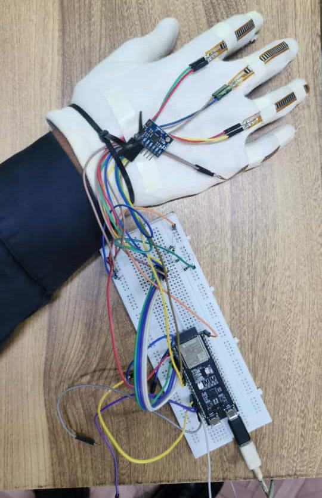
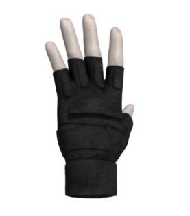
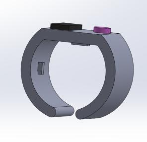
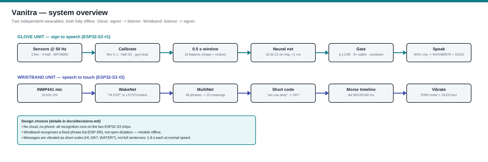
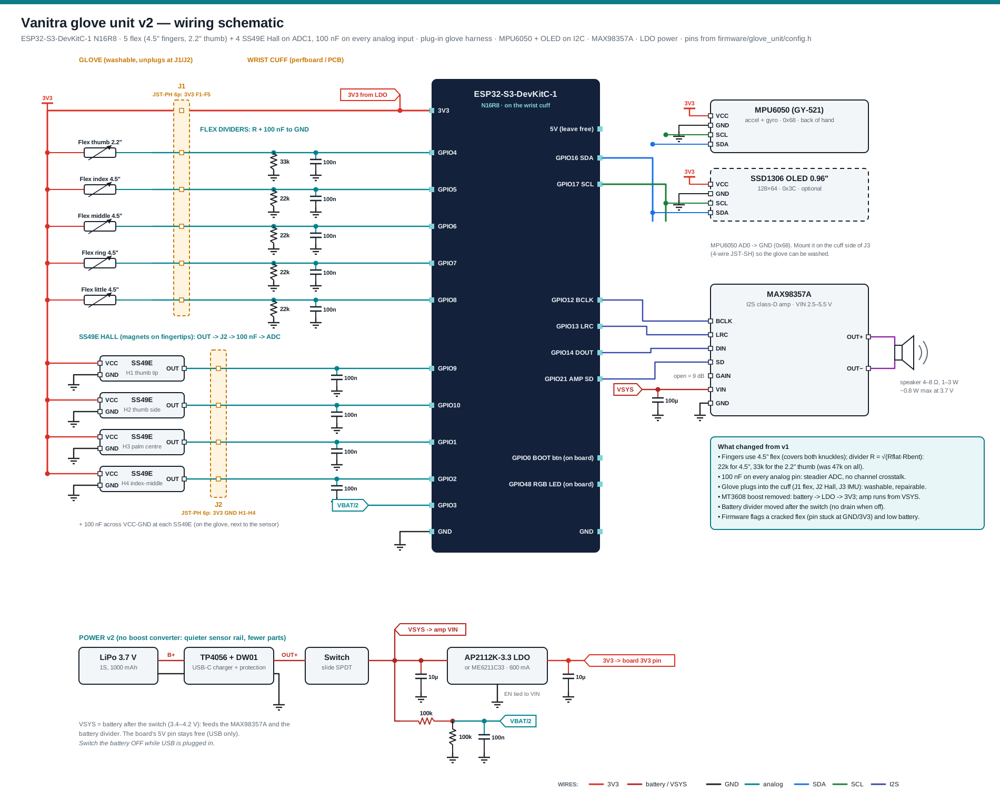
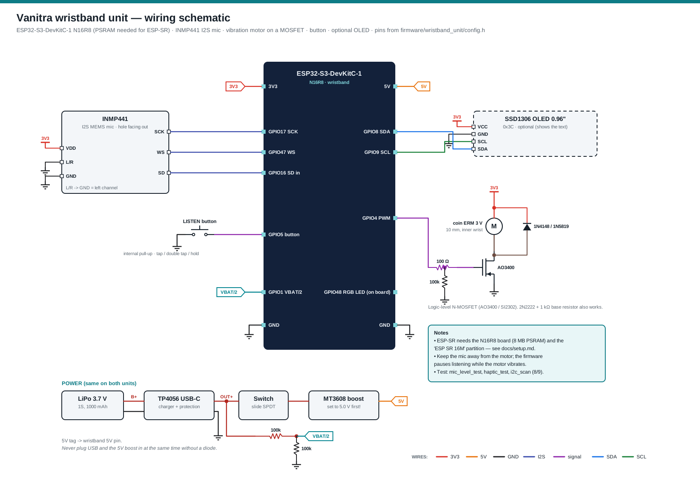

<div align="center">

# VANITRA

**A wearable assistive device for two-way deaf–mute communication**<br>
Sign-to-speech glove + speech-to-touch wristband · fully offline on two ESP32-S3 boards<br>
B.E. Mechanical and Mechatronics Engineering · Thakur College of Engineering and Technology (TCET), Mumbai

[](CHANGELOG.md) [](ROADMAP.md)    [](LICENSE)

</div>

Vanitra lets a deaf–mute person and a hearing person talk **both ways, with no phone, no interpreter and no internet**. The signer wears a **glove** that turns signs into spoken words. The hearing person's speech is picked up by a **wristband** that taps the message onto the signer's wrist as short Morse-code vibrations.

| Prototype glove (SCS mini project) | Glove CAD | Wristband CAD |
|---|---|---|
|  |  |  |

---

## The problem

About **1.5 billion people** worldwide live with some hearing loss, and **430 million** have disabling hearing loss (WHO). India has roughly **63 million** people with hearing impairment. Many of them rely on sign language, which most hearing people do not understand. Interpreters are scarce and expensive. Existing sign-language gloves usually work **one way only** (sign → speech) and often need a phone or the cloud. Almost none let the deaf user *receive* speech without looking at a screen. See the [literature review](docs/research/literature.md).

## How it works



| Unit | What it does |
|---|---|
| **Glove** (ESP32-S3 #1) | 5 flex sensors (finger bend), 4 SS49E Hall sensors with fingertip magnets (finger contact), MPU6050 (hand tilt and motion). Sampled at 50 Hz, calibrated per user, and summarised every 100 ms as 16 features over a 0.5 s window. A small neural network (16→32→21) runs **on the chip** and recognises 20 signs plus "no sign". A confidence gate (≥ 0.85, 3 matching answers in a row) stops flicker. The word is then **spoken** through a MAX98357A amplifier and also shown on an optional OLED. |
| **Wristband** (ESP32-S3 #2) | An INMP441 microphone feeds **Espressif ESP-SR**, which runs offline on the chip. The hearing person says **"Hi ESP"**, or the wearer taps the button, then speaks one of 49 phrases. Each phrase maps to one of 22 meanings, and each meaning has a short code that the band vibrates in Morse: "are you okay" → **OK?**, "do you want water" → **WATER?**, "watch out" → three long buzzes. The full text is shown on an optional OLED. Listening pauses while the motor runs. |

Every design decision, including how the inconsistencies in the earlier reports were resolved, is recorded in [docs/decisions.md](docs/decisions.md).

## Progress

> **Update (18 Oct 2026): v2.0-dev.** After a [design review](docs/design_review_v2.md) the glove now has hardware v2 (4.5″ flex, 100 nF ADC filtering, LDO power, plug-in harness) and a **temporal CNN** gesture model with a PC live decoder. The CNN is a placeholder trained on synthetic data, like the MLP. The glove sketch passes the PC parity tests and a stub compile, but has **not been rebuilt with the ESP32 core or run on hardware since these changes**.
>
> **Status (16 Oct 2026): the v1.0 software is complete; the hardware has not been tested with it yet.** Both firmwares compile for the ESP32-S3 (Arduino core 3.2.0). The ML pipeline and the PC unit tests pass: Python and C++ give identical features and outputs. **The model in `model.h` is a placeholder trained on synthetic data.** It must be retrained on real glove recordings (see [docs/ml_pipeline.md](docs/ml_pipeline.md)). The accuracy figures in the 2025 reports came from the earlier prototype and still need to be re-measured with this firmware ([docs/testing.md](docs/testing.md)).

| Version | Milestone | Status |
|---|---|---|
| v0.1 | SCS mini project (AY 2025-26): concept, CAD, Wokwi simulation, breadboard glove, blue book, IEEE paper draft | ✅ |
| v0.2 | Hackanova 5.0 (hardware track): deck + 36-hour build plan | ✅ |
| **v1.0** | **This repo:** one consistent pin map, glove + wristband firmware, ML pipeline, voice clips, schematics, BOM, PC tests | ✅ software · 🔧 hardware next |
| **v2.0-dev** | Design review: glove hardware v2 schematic, temporal CNN + live decoder, sensor-fault and low-battery warnings | ✅ software · 🔧 hardware next |
| v1.1 | Bench bring-up with the test sketches, calibration, first real dataset (≥ 3 signers) | 📋 |
| v1.2 | Wristband on hardware: phrase tuning, Morse legibility test | 📋 |
| v1.3 | Measured accuracy / latency / battery → update the report and paper | 📋 |
| v2.0 | Custom PCB, enclosure, ISL vocabulary, glove ↔ wristband link | 📋 |

Week-by-week plan and checklist: **[ROADMAP.md](ROADMAP.md)** · what changed: **[CHANGELOG.md](CHANGELOG.md)**

## Repository layout

```
firmware/
  glove_unit/          sign -> speech (ESP32-S3): sensors, temporal CNN (cnn.h) or feature MLP, voice, OLED
  wristband_unit/      speech -> Morse vibration (ESP32-S3 + ESP-SR): phrases.csv -> commands.h
  tests/               i2c_scan, glove_sensor_monitor, speaker_test, haptic_test, mic_level_test
  tests/host/          PC unit tests (features + net parity with Python, Morse timing)
  wokwi/glove/         Wokwi simulation of the glove (pots = flex / Hall)
ml/
  vocabulary.csv       the 20 signs + REST and what the glove says for each
  collect_data.py      record labelled takes from the glove over USB
  train.py             v1 MLP: train + cross-validate + export firmware/glove_unit/model.h
  vanitra_cnn.py       v2 temporal CNN in NumPy (mirror of firmware/glove_unit/cnn.h)
  train_cnn.py         v2: train CNN, compare with MLP (clean + drifted), export model_cnn.h
  live_decoder.py      decode the glove live on a laptop (top-3, transcript, speech)
  make_voice_clips.py  build voice_clips.h (espeak-ng or your own recordings)
  make_synthetic_data.py   fake data to test the pipeline without hardware
tools/
  make_sr_commands.py  phrases.csv -> ESP-SR phoneme table (commands.h)
hardware/
  bom.csv              parts list with approximate prices
docs/
  architecture.md  wiring.md  setup.md  ml_pipeline.md  testing.md  decisions.md
  wiring/          schematics (SVG + PNG) and the script that draws them
  research/        literature review and comparison
  report/          blue book, IEEE paper (v1, v2), errata
  presentation/    SCS deck (.pptx) and Hackanova 5.0 deck (.pdf)
  images/          CAD, prototype photos, Wokwi screenshots
```

## Quick start

1. **Wire it**: [docs/wiring.md](docs/wiring.md). Check each part with the sketches in `firmware/tests/`.
2. **Flash it** with the Arduino IDE and **esp32 core 3.x**, board *ESP32S3 Dev Module*, *Flash 16MB*, *PSRAM: OPI PSRAM*, *USB CDC On Boot: Enabled*:
   - Glove: partition **16M Flash (3MB APP/9.9MB FATFS)**. Install the *Adafruit SSD1306* and *Adafruit GFX* libraries.
   - Wristband: partition **ESP SR 16M (3MB APP/7MB SPIFFS/2.9MB MODEL)**.
3. **Calibrate the glove**: hold BOOT for 2 s, open your hand flat, then make a fist when the LED turns yellow.
4. **Train on your own hands**:
   ```bash
   pip install -r ml/requirements.txt
   python ml/collect_data.py --port COM5 --user manas
   python ml/train.py
   ```
   Re-flash the glove.
5. **Wristband**: say "Hi ESP, are you okay". Or tap the button and say the phrase. You can also type any text in the Serial Monitor to feel it in Morse.

Full steps: [docs/setup.md](docs/setup.md). No hardware? Run `python ml/make_synthetic_data.py && python ml/train.py --synthetic`, then `make -C firmware/tests/host`, or try the [Wokwi simulation](firmware/wokwi/glove).

## Wiring

| Glove | Wristband |
|---|---|
|  |  |

## Bill of materials

| Build | Approx. cost |
|---|---|
| Glove v2 (ESP32-S3, 4 × 4.5″ + 1 × 2.2″ flex, 4 Hall, IMU, amp + speaker, OLED, LDO, connectors, glove) | ≈ ₹6,600 |
| Wristband (ESP32-S3, INMP441, motor + driver, button, OLED, case, MT3608) | ≈ ₹1,600 |
| Power ×2 (LiPo, TP4056, switch) + wiring | ≈ ₹1,100 |
| **Total** | **≈ ₹9,300** |

These are approximate Indian prices for 2026. Flex sensors are most of the glove's cost: the 4.5″ upgrade adds about ₹1,980. Keeping 2.2″ sensors on every finger brings the total to about ₹7,350 (see the [design review](docs/design_review_v2.md)). Item by item: [hardware/bom.csv](hardware/bom.csv).

## Results so far

The SCS blue book (2025) reports **90–94 %** gesture accuracy on the trained set and **85–90 %** speech-to-Morse recognition for clear speech. It also reports **350–500 ms** end-to-end latency. These were measured on the first breadboard prototype under controlled conditions. The v1.0 firmware is new code (new features, a new model and ESP-SR on the wristband), so these numbers will be re-measured using the protocol in [docs/testing.md](docs/testing.md) and published in `docs/results/`.

## Future scope
FSR pressure sensors on the fingertips · Indian Sign Language (ISL) vocabulary · temporal models (1D-CNN / GRU) for continuous signing · an ESP-NOW link so the wristband confirms what the glove said · haptic patterns beyond Morse (syllable / icon codes) and guided Morse training · Hindi and Marathi phrases · custom PCB, sweat-proof enclosure and low-power modes.

## Team
| Name | Roll no. | GitHub |
|---|---|---|
| Manas Pednekar | 36 | [@Manas-36](https://github.com/Manas-36) |

Guide: **Dr. Archana Belge**, Head of Department, Mechanical and Mechatronics Engineering · Full credits: [CONTRIBUTORS.md](CONTRIBUTORS.md)

## Licence
MIT. See [LICENSE](LICENSE). The ESP-SR models are Espressif's and are covered by their own licence.
