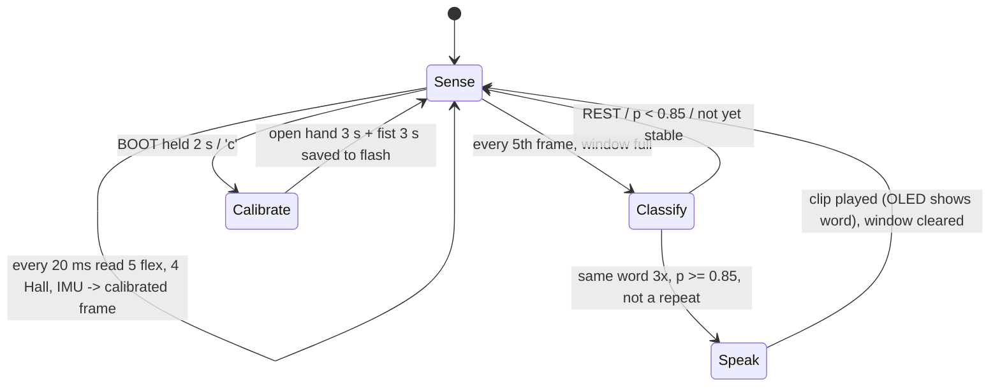
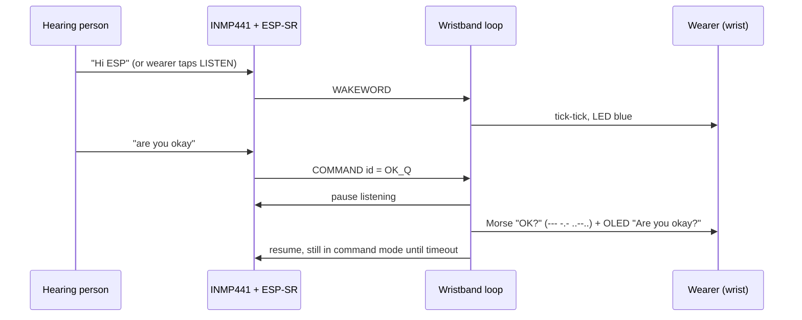

# Architecture

Vanitra is two independent wearables. Neither needs a phone, Wi-Fi or the other unit to work.

## Glove unit — sign → speech

| Stage | File | Detail |
|---|---|---|
| Sensing | `sensors.h` | ADC1 at 12 bit with 11 dB attenuation, 4-sample average per channel. MPU6050 at ±4 g / ±500 °/s with a 44 Hz low-pass filter. |
| Calibration | `sensors.h` | flex: (mV − straight) / (bent − straight), clamped to 0..1. Hall: \|mV − baseline\| with hysteresis 250/150 mV. Gyro bias removed. Stored with `Preferences` (NVS). |
| Window + features | `features.h` | ring buffer of 25 frames (0.5 s) → 16 features (see [ml_pipeline.md](ml_pipeline.md)) |
| Model (v2, default) | `classifier.h`, `cnn.h`, `model_cnn.h` | 1.0 s raw window → conv k5 24 → pool → conv k5 32 → pool → conv k3 32 → mean+max → dense → softmax |
| Model (v1) | `mlp.h`, `model.h` | standardise → dense 32 ReLU → dense N → softmax |
| Decision | `glove_unit.ino` | REST resets the state. A word must reach the confidence threshold and stay stable, with a repeat lockout and a 600 ms cooldown after speaking. |
| Output | `voice.h`, `display.h` | 16 kHz WAV clip from flash → I2S → MAX98357A. The amp is shut down between words. Optional OLED. |

**Latency budget (design):** the sign must fill most of the 0.5 s window. The model runs every 100 ms, and three stable answers add 200 ms. The amplifier starts in about 5 ms. From sign held to voice start is about 300–500 ms, which matches the 350–500 ms target, but it still has to be measured (T5).

## Wristband unit — speech → touch

| Stage | File | Detail |
|---|---|---|
| Audio | `wristband_unit.ino` | I2S 16 kHz 16-bit stereo frame (INMP441 on the left slot), as in Espressif's example |
| Recognition | ESP-SR (core library) | AFE + WakeNet "Hi ESP" + MultiNet English. The phrase table and phonemes are generated from `phrases.csv` → `commands.h`. |
| Message | `commands.h` | meaning → short Morse code + display text |
| Haptics | `morse.h`, `haptic.h` | text → on/off timeline (standard Morse ratios 1:3:1:3:7) → non-blocking PWM player on an ERM motor |
| UI | `wristband_unit.ino` | tap = listen, double tap = replay, hold = speed. The serial port accepts free text. The speed is stored in NVS. |

## Why two separate units?
- The signer wears both, but each direction has different hardware needs. The glove needs many ADC channels and a speaker. The wristband needs PSRAM and CPU for speech, plus a quiet place for the microphone.
- If one unit fails, the other still works.
- A later ESP-NOW link (v2.0) can let the wristband confirm, by touch, the word the glove just spoke.
