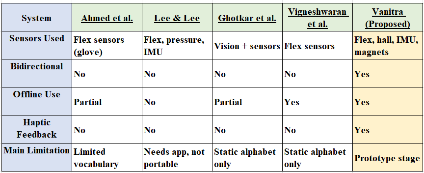

# Literature review and gap analysis

Summarised from the blue book (Ch. 2) and the IEEE paper (Sec. III). The reference numbers match the paper.

## Need
- More than **1.5 billion** people live with some degree of hearing loss; **430 million** have disabling hearing loss, including 34 million children. This is projected to exceed **700 million by 2050** [1][2].
- Only about **17 %** of the people who could benefit from hearing aids use them, held back by cost, access and awareness [4][6].
- Unaddressed hearing loss costs about **US$ 980 billion** a year worldwide [6].
- India has about **63 million** people with hearing impairment. Of those aged 15–59, only about **26 %** have stable employment [3][5].

## Existing systems

| System | Sensors | Two-way | Offline | Haptic reception | Main limitation |
|---|---|---|---|---|---|
| Ahmed et al. [8] | flex (glove, Arduino) | ✗ | partial | ✗ | small vocabulary, speech output only |
| Lee & Lee [9] | flex, pressure, IMU + phone app | ✗ | ✗ | ✗ | needs smartphone / connectivity |
| Ghotkar et al. [10] | camera (ISL) | ✗ | partial | ✗ | camera set-up and lighting, not wearable |
| Vigneshwaran et al. [11] | flex + HMM | ✗ | ✓ | ✗ | static alphabet only |
| **Vanitra** | flex, Hall + magnets, IMU · mic | ✓ | ✓ | ✓ (Morse) | prototype stage, fixed vocabularies |

## Gaps Vanitra targets
1. **Bidirectional communication.** Most gloves only go from sign to speech. Hardly any carry the hearing person's speech back to the deaf user [8][14].
2. **Offline use.** Many depend on a phone, a PC or the internet.
3. **Haptic reception.** This is rarely built in, even though it works without a screen or sound [11].
4. **Dynamic signs.** Most systems recognise static letters only [10]. Vanitra adds motion features from an IMU.
5. **Portability.** Camera systems and phone-tethered gloves are not true wearables.

## On-device ML
TinyML on ESP32-class chips makes real-time gesture and keyword recognition possible without the cloud [12]. Model size, dataset diversity, multiple languages and battery life are still open problems [13]. Espressif's ESP-SR (WakeNet / MultiNet) is a production example of offline phrase recognition on the ESP32-S3.

## References
1. World Health Organization, "Deafness and hearing loss," fact sheet. https://www.who.int/news-room/fact-sheets/detail/deafness-and-hearing-loss
2. World Health Organization, "Hearing loss," health topic. https://www.who.int/health-topics/hearing-loss
3. "Deafness in India," Wikipedia. https://en.wikipedia.org/wiki/Deafness_in_India
4. World Federation of the Deaf, "FAQs." https://wfdeaf.org/contact/faqs/
5. "The Ongoing Challenges of Hearing Loss: Stigma, Socio-Cultural Differences, and Accessibility Barriers," MDPI. https://www.mdpi.com/2039-4349/15/3/46
6. "How home working leaves deaf people out of the loop during coronavirus," The Guardian, Apr. 2020. https://www.theguardian.com/society/2020/apr/22/how-home-working-leaves-deaf-people-out-loop-coronavirus
7. S. Arafat et al., "Speaking System for Dumb People Along With Emergency Location Sharing," IJCRT, vol. 10, no. 5, May 2022.
8. S. Ahmed, R. Islam, M. S. R. Zishaan, M. R. Hassan, "Electronics speaking system for speech challenged people," 2015.
9. B. G. Lee, S. M. Lee, "Smart wearable hand device for sign language interpretation system with sensors fusion," IEEE Sensors Journal, vol. 18, no. 3, 2018 (online Apr. 2017).
10. A. S. Ghotkar, "Hand gesture recognition for Indian Sign Language," Proc. ICCCI, 2012, pp. 1–4.
11. S. Vigneshwaran, M. Shifa Fathima, V. Vijay Sagar, R. Sree Arshika, "Hand gesture recognition and voice conversion system for dumb people," 2019.
12. "A TinyML solution for an IoT-based communication device for hearing impaired," Expert Systems with Applications, 2024. https://www.sciencedirect.com/science/article/abs/pii/S0957417424000125
13. T. Jima et al., "Recognition of static/dynamic gesture: a gesture-driven editing system," J. Visual Languages and Computing, vol. 10, no. 3, 1999.
14. MiMU Gloves documentation. https://mimugloves.com/documentation/home/
15. ScienceDirect article. https://www.sciencedirect.com/science/article/pii/S1877050924016144
16. Espressif Systems, ESP32-S3 datasheet.
17. InvenSense, MPU-6050 datasheet.
18. Espressif Systems, ESP-SR speech recognition framework. https://github.com/espressif/esp-sr
