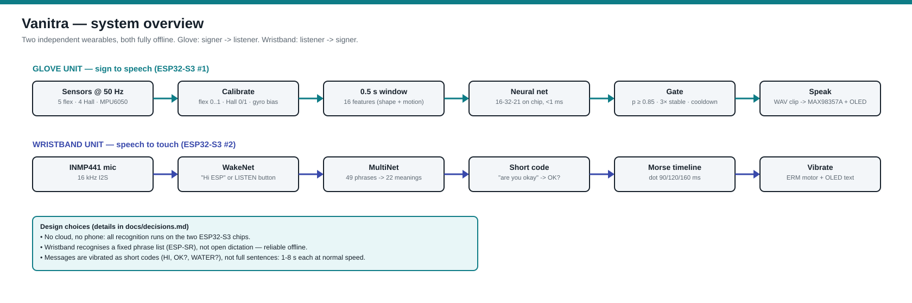
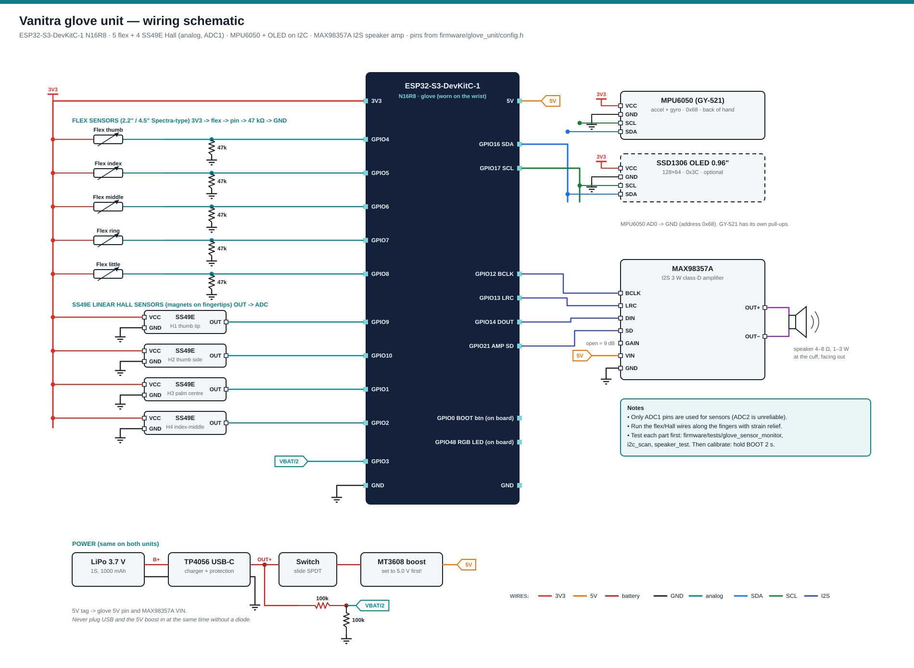
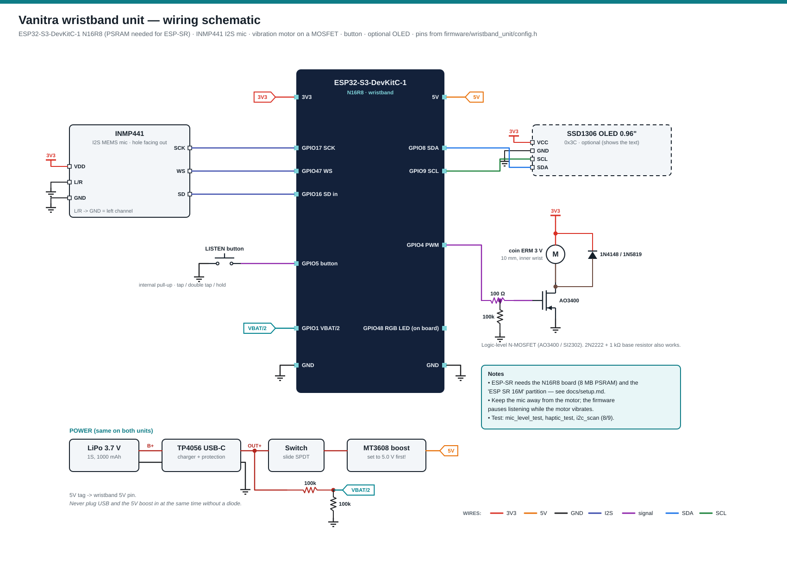

# Wiring

The schematics are generated by `docs/wiring/make_schematics.py`; re-run it after changing a pin. The SVG files can be zoomed without losing quality. Use the PNG files for slides, the report and Notion. The pins are copied from `firmware/glove_unit/config.h` and `firmware/wristband_unit/config.h`, which are the source of truth.

## System

## Glove unit

| Part | Part pin | ESP32-S3 | Notes |
|---|---|---|---|
| Flex thumb | one leg → 3V3, other leg → **GPIO4** + 47 kΩ → GND | GPIO4 (ADC1_CH3) | voltage divider |
| Flex index | same | GPIO5 (ADC1_CH4) | |
| Flex middle | same | GPIO6 (ADC1_CH5) | |
| Flex ring | same | GPIO7 (ADC1_CH6) | |
| Flex little | same | GPIO8 (ADC1_CH7) | |
| SS49E H1 (thumb tip) | VCC 3V3 · GND · OUT | GPIO9 (ADC1_CH8) | flat face towards the magnet |
| SS49E H2 (thumb side, index contact) | OUT | GPIO10 (ADC1_CH9) | |
| SS49E H3 (palm centre, curled fingertips) | OUT | GPIO1 (ADC1_CH0) | |
| SS49E H4 (side of index, touches middle) | OUT | GPIO2 (ADC1_CH1) | |
| MPU6050 (GY-521) | VCC 3V3 · GND · SDA · SCL · AD0 → GND | SDA **GPIO16**, SCL **GPIO17** | address 0x68, back of hand |
| SSD1306 OLED (optional) | VCC 3V3 · GND · SDA · SCL | same I2C bus | address 0x3C |
| MAX98357A | BCLK · LRC · DIN · SD | GPIO12 · GPIO13 · GPIO14 · GPIO21 | VIN 5V, GND, GAIN open (9 dB) |
| Speaker | OUT+ / OUT− of the amp | — | 4–8 Ω, never to GND |
| Battery sense | battery + → 100k → **GPIO3** → 100k → GND | GPIO3 (ADC1_CH2) | reads half the battery voltage |
| BOOT button | on the board | GPIO0 | short = repeat word, hold 2 s = calibrate |
| RGB LED | on the board | GPIO48 (v1.0 board) / GPIO38 (v1.1) | `RGB_BUILTIN` picks the right one |

**Placement on the glove:** flex sensors run along the back of each finger, with the printed side facing out and the base fixed at the knuckle. The free end should slide in a fabric sleeve. Put **magnets on the fingertips** (index, middle, ring, little) and the **Hall sensors on the thumb tip, the thumb side, the palm centre and between the index and middle fingers**. The MPU6050 goes flat on the back of the hand. The ESP32, amplifier and battery go on the wrist cuff, with the speaker facing outwards.

## Wristband unit

| Part | Part pin | ESP32-S3 | Notes |
|---|---|---|---|
| INMP441 mic | SCK | **GPIO17** | |
| | WS | **GPIO47** | |
| | SD | **GPIO16** | mic data out → ESP32 in |
| | L/R | GND | left channel |
| | VDD / GND | 3V3 / GND | |
| Vibration motor driver | MOSFET gate via 100 Ω, 100 kΩ gate → GND | **GPIO4** (PWM 5 kHz) | motor between 3V3 and drain, diode across motor (cathode to 3V3) |
| LISTEN button | one leg → GPIO5, other → GND | **GPIO5** | internal pull-up |
| SSD1306 OLED (optional) | SDA / SCL | **GPIO8 / GPIO9** | 0x3C |
| Battery sense | 100k / 100k divider | **GPIO1** | |
| RGB LED | on the board | GPIO48 | |

Keep the microphone on the outside of the band and the motor on the inside, against the skin. The firmware pauses listening while the motor runs.

## Power (both units)
LiPo 3.7 V → **TP4056** (USB-C, with protection) → slide switch → **MT3608** boost → set to **5.0 V before connecting** → board **5V** pin (and the MAX98357A VIN on the glove). The board's regulator makes 3.3 V for the sensors.
Do not power the board from USB and the boost converter at the same time unless there is a diode on the 5 V line. The simplest rule is to switch the battery off while the USB cable is plugged in.

## Pins to avoid on the ESP32-S3-DevKitC-1 N16R8
- GPIO 35, 36, 37: used by the octal PSRAM
- GPIO 19, 20: USB
- GPIO 0, 3, 45, 46: strapping pins (GPIO0 is only used as the BOOT button, and GPIO3 only for battery sensing through a divider)
- ADC2 (GPIO 11–20): not used for analog
